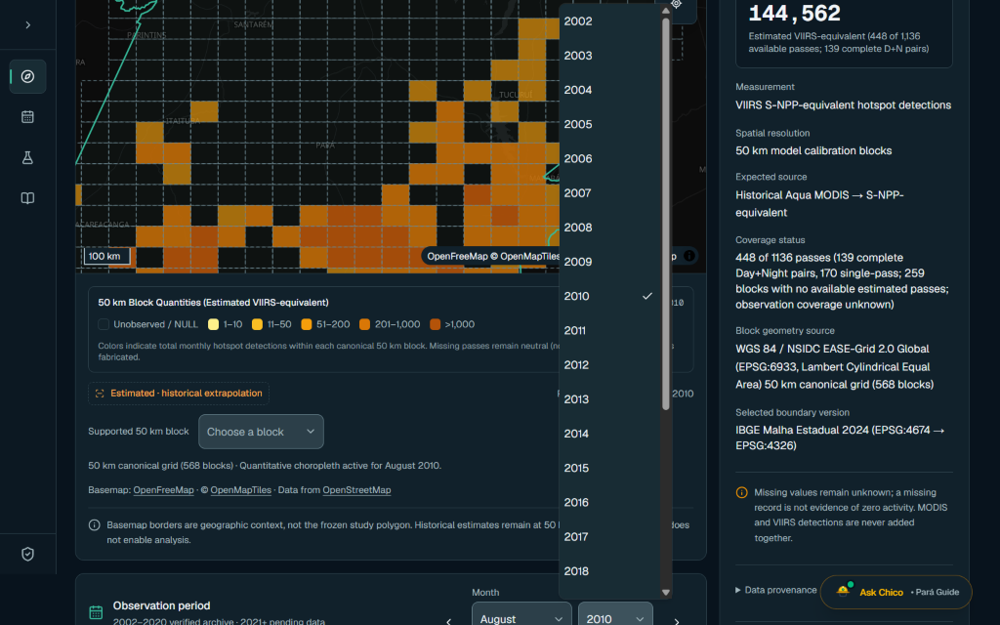
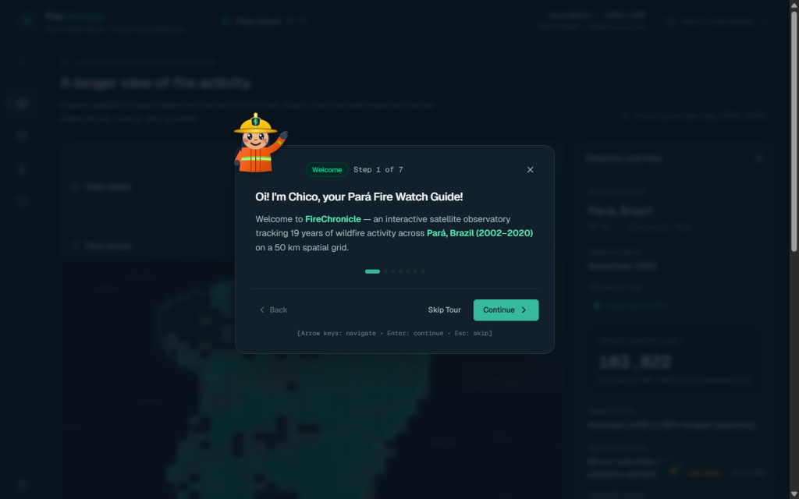
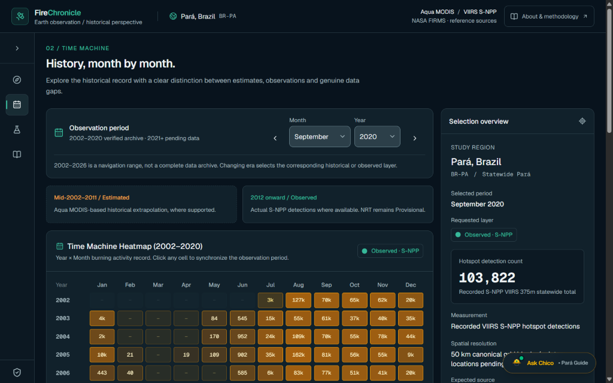
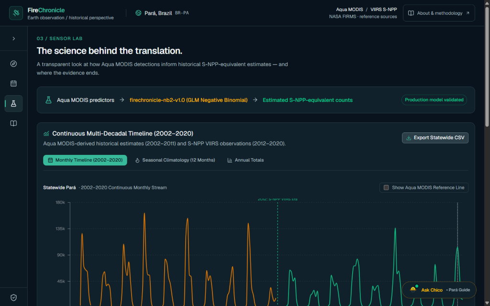
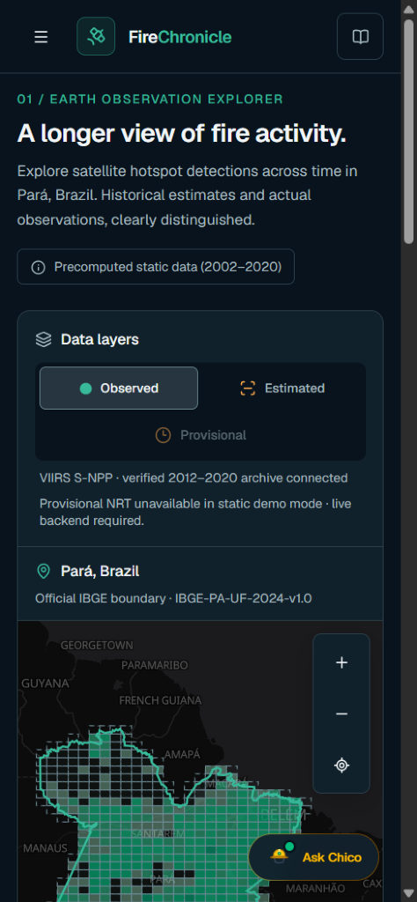

# FireChronicle

### Multi-Decadal Earth Observation & Harmonization of Satellite Active Fire Hotspots across Pará, Brazil (2002–2020)

[](https://www.spaceappschallenge.org/)
[](https://firechronicle.vercel.app/)
[](https://github.com/inan001/firechronicle)
[](https://firechronicle.vercel.app/sensor-lab)
[](https://github.com/inan001/firechronicle)
[-6366f1?style=for-the-badge)](https://firechronicle.vercel.app/)

> **NASA Space Apps Challenge 2026** — *Harmonization of MODIS and VIIRS Hot Spots*  
> **Team:** Team Meghna  
> **Production Platform:** [https://firechronicle.vercel.app/](https://firechronicle.vercel.app/)  
> **Authoritative Release Branch:** `main` (Commit `dd6bd84`)  

---

## 1. Executive Overview & The Decadal Sensor Challenge

FireChronicle is a public satellite Earth observation analytics platform tracking 19 years of active fire hotspot detections across all **568 canonical 50 km grid blocks** in **Pará, Brazil (`BR-PA`)**. The platform structures a complete 19-year, 228-calendar-month timeline (January 2002 – December 2020), spanning the 222 operational satellite months from July 2002 through December 2020 alongside 6 unsupported pre-commissioning months (January–June 2002).


*Figure 1: Explore Pará interactive workspace displaying the August 2005 severe drought period (~161,941 estimated detections) across the official IBGE 2024 boundary and 568 canonical 50 km blocks.*

### The Environmental Problem: The Satellite Sensor Discontinuity
Long-term environmental monitoring of the Amazon rainforest relies heavily on NASA's spaceborne thermal infrared active-fire instruments:
- **Aqua MODIS (2002–present):** 1 km spatial resolution at nadir.
- **Suomi-NPP VIIRS (2012–present):** 375 m I-band resolution (~10× smaller ground footprint at nadir).

Because VIIRS operates with a significantly smaller pixel footprint and higher thermal sensitivity, it detects smaller and lower-intensity fires that MODIS frequently does not register. However, spaceborne thermal detection of sub-canopy burning remains constrained by forest canopy obscuration, smoke attenuation, and cloud cover.

Crucially, differences in sensor resolution and detection thresholds create a major **sensor discontinuity** between the two observational records. Comparing or aggregating raw Aqua MODIS counts (2002–2011) with raw VIIRS counts (2012–2020) without cross-sensor calibration distorts interpretations of multi-decadal fire-detection trends. Directly summing raw counts across the 2012 sensor transition is methodologically invalid.

### The Scientific Solution: Empirically Calibrated Harmonization
FireChronicle bridges this 10-year observational gap:
1. **Nine Years of Direct Overlap:** Calibrated on 23,010 paired-positive cell-months ($M > 0$ and $V > 0$) across the 2012–2020 concurrent observation window.
2. **Negative Binomial GLM (NB2 v1.0):** An empirically fitted Generalized Linear Model accounting for strong overdispersion ($\alpha = 0.3394$), seasonal fixed effects, and diurnal day/night overpass dynamics.
3. **Strict Era Separation:** Reconstructs VIIRS-equivalent historical activity back to July 2002 while strictly distinguishing the **Estimated Era (2002–2011)** from the **Observed Era (2012–2020)**.

### Why FireChronicle Matters

Understanding how fire activity changes across decades is important for studying the Amazon's environment. But when satellite sensors detect hotspots differently, changes in the recorded counts may reflect differences in the instruments rather than changes in fire activity alone.

FireChronicle helps environmental researchers, conservation organizations, and Earth-observation analysts explore historical fire-detection patterns more consistently. By connecting statistically estimated historical detections with observed VIIRS records—and making the results accessible through interactive maps and timelines—it supports more informed interpretation of long-term environmental data.

**Our goal is simple: make decades of satellite fire observations easier to compare, explore, and understand.**

---

## 2. Interactive Feature Gallery

FireChronicle presents six core modules designed for researchers, environmental monitors, and competition judges:

| Feature Module | Purpose & Capabilities | Visual Preview |
| :--- | :--- | :---: |
| **Explore Pará**<br>`/` | Interactive MapLibre GL choropleth rendering the official **IBGE 2024** state boundary and 568 canonical 50 km blocks (EPSG:6933). Dynamically shifts between **Warm Amber** (Estimated era) and **Vibrant Emerald** (Observed era). Hover cards and click inspection display localized block time series, hotspot detection counts, and pass coverage metadata (reconciling complete Day+Night passes and preserving NULLs for unobserved blocks). |  |
| **Chico — Interactive Science Guide**<br>*Onboarding Tour & Q&A* (`/api/chico`) | Chico is FireChronicle's interactive science guide, featuring a seven-step onboarding tour and rule-based scientific Q&A safeguards. The current production configuration uses deterministic rulebook-fallback responses; optional generative AI integration is available through a separately configured backend adapter.<br><br>• **7-Step Onboarding Tour:** Inspired by Amazonian conservationist Chico Mendes, Chico introduces users to sensor discontinuities, spatial grids, the 228-month calendar timeline (222 operational months from July 2002 through December 2020, with Jan–Jun 2002 unsupported), and diurnal overpasses. Fully keyboard accessible (`Arrows`, `Enter`, `Esc`) with instant tour replay.<br>• **Safeguarded Science Guidance:** Directly answers queries regarding sensor differences, era boundaries, and missing coverage from an audited local rulebook without requiring external network services. | <br><br> |
| **Time Machine**<br>`/time-machine` | 19-Year Calendar Matrix spanning all 228 calendar months (January 2002 – December 2020). Clearly separates the 6 unsupported pre-commissioning months (Jan–Jun 2002, preserved as `NULL`) from the 222 operational months (July 2002 – December 2020). Accurately distinguishes partial observation launch periods (July 2002, January 2012) and the audited **March 2004 Insufficient Coverage fix** (hatched visual pattern; preserved as `NULL`, not zero). Neither 228 nor 222 implies universal data availability: orbital gaps and missing passes are strictly maintained as unobserved `NULL` values. Includes Recharts seasonal climatology and annual totals. |  |
| **Sensor Lab**<br>`/sensor-lab` | Transparent public evaluation lab presenting authoritative holdout validation benchmarks (Strategy A Temporal & Strategy B Geographic), full GLM NB2 parameters, and a multi-decadal continuous timeline with an interactive raw Aqua MODIS reference toggle. |  |
| **Responsive Interface**<br>*Mobile & Desktop* | Touch-friendly responsive layout supporting phone and tablet viewports with collapsable analytical sheets, touch-optimized temporal scrubbing, and fluid MapLibre viewport controls. |  |
| **CSV Data Export**<br>*RFC 4180 Standard* | One-click instant data export for Statewide Pará or any individual 50 km block across the complete 228-month calendar grid (including the 6 pre-commissioning `NULL` rows and the 222 operational months from July 2002 to December 2020). Fully preserves `NULL` values for unobserved or incomplete passes and separates Day, Night, and strict `daynight=ALL` observation channels according to RFC 4180 standards. | *Available on all views* |

---

## 3. Authoritative Scientific Validation

The production **NB2 v1.0** model was rigorously validated against a standard Ratio-of-Totals baseline ($k = \sum V / \sum M$) using two strictly held-out evaluation splits.

### Benchmark Validation Results

| Evaluation Strategy | Data Split & Sample Size | NB2 v1.0 MAE | Ratio Baseline MAE | Improvement (Error Reduction) | Additional Validated Metrics |
| :--- | :--- | :---: | :---: | :---: | :--- |
| **Strategy A: Prospective Temporal Holdout** | **Train:** 2012–2018 ($N = 17,919$)<br>**Test:** 2019–2020 ($N = 5,091$) across 24 unseen months | **35.44** | 44.99 | **21.2% lower MAE**<br>*(Deviance: -54.8%)* | • Poisson Deviance: **25.01** (vs 55.31)<br>• Monthly WAPE: **16.79%** (vs 20.48%)<br>• Monthly $R^2$: **0.9148** (vs 0.9009)<br>• Aggregate Bias: **-11.50%** (vs -12.91%) |
| **Strategy B: Grouped Geographic Holdout** | **Train:** 376 spatial blocks ($N = 17,863$)<br>**Test:** 94 completely withheld blocks ($N = 5,147$) | **35.79** | 53.87 | **33.6% lower MAE**<br>*(Deviance: -62.8%)* | • Poisson Deviance: **20.95** (vs 56.35)<br>• Spatial WAPE: **34.15%** (vs 51.39%)<br>• Monthly Correlation: **0.994** |

> [!IMPORTANT]
> **Metric Clarification:** The percentage improvements above represent **reductions in Mean Absolute Error (MAE) and Poisson Deviance** relative to the ratio baseline. They do not represent percentage accuracy scores. Monthly $R^2 = 0.9148$ denotes the coefficient of determination for monthly aggregate variance ($1 - \frac{\text{SS}_{\text{res}}}{\text{SS}_{\text{tot}}}$).

### Frozen Production Model Specification (NB2 v1.0)
- **Model Family:** Generalized Linear Model (GLM).
- **Distribution:** Negative Binomial (`NB2`) with logarithmic link function:
  $$\log(\mu_i) = \beta_0 + \beta_1 \log(1 + M_i) + \sum_{m=2}^{12} \beta_m \mathbb{I}(\text{month}_i = m) + \beta_N \mathbb{I}(\text{daynight}_i = \text{'N'})$$
- **Dispersion Parameter ($\alpha$):** `0.3394` (demonstrating variance $\text{Var}(Y) = \mu + \alpha \mu^2$, rejecting equidispersion Poisson assumptions).
- **Baseline Calibration Multiplier ($k$):** `6.0538`.
- **Model Fit Criteria:** AIC = `210,357.6` · BIC = `210,478.2`.
- **Spatial Fixed Effects:** Intentionally excluded to guarantee spatially uniform calibration across all 568 blocks without localized overfitting.

---

## 4. Scientific Integrity, Rules & Methodological Constraints

FireChronicle adheres strictly to the **Team Scientific Rulebook** and NASA Earth Science data integrity standards:

1. **Hotspot Detections $\neq$ Wildfire Incidents:** A satellite active-fire hotspot represents a 375 m or 1 km pixel footprint exhibiting a thermal radiation anomaly at satellite overpass time. A single large wildfire can generate dozens of contiguous pixel detections over successive overpasses, whereas smaller fires beneath dense forest canopy or obscured by cloud and smoke cover may produce none. Detections must never be cited as discrete wildfire perimeter counts.
2. **Missing Satellite Coverage $\neq$ Zero Fires:** Orbital gaps, sensor outages, and cloud obscuration prevent thermal detection. An unobserved block or month is strictly preserved as `NULL` / empty, never zero.
3. **Strict Day/Night Aggregation Contract (`daynight=ALL`):** At the 50 km block level, a combined Day+Night total is valid if and only if both passes exist; if either pass is missing, the combined value remains `NULL`. Statewide sums aggregate exclusively complete D+N pairs to eliminate diurnal sampling bias.
4. **Verified March 2004 Coverage Fix:** In March 2004, Aqua MODIS experienced orbital pass gaps resulting in zero complete D+N pairs. The platform displays March 2004 with a distinct hatched visual pattern and status `insufficient_coverage` (`value = null`), eliminating the historical defect where an incomplete month appeared falsely as zero fire activity.
5. **Timeline Accounting (228 Calendar Months vs. 222 Operational Months):**
   - The full 19-year timeline encompasses **228 calendar months** (19 years × 12 months, 2002–2020).
   - **January–June 2002 (6 months):** NASA Aqua was launched on May 4, 2002; operational active fire science data began in July 2002. The first 6 calendar months are preserved as unsupported pre-commissioning (`null`).
   - **July 2002 – December 2020 (222 months):** Constitute the active operational satellite observation window.
   - **Partial Coverage & Preserved NULLs:** Citing 222 operational months does not imply all months contain complete or valid observations. Launch periods (July 2002 with 3,462.9 estimated detections; January 2012 with 445 detections) represent partial observations, pass-deficient periods (such as March 2004) lack complete Day+Night coverage, and unobserved passes or blocks are strictly preserved as `NULL`, never assumed to represent zero fire activity.
6. **Spatial Scale Integrity:** All historical inferences remain strictly at the 50 km canonical grid cell level (NSIDC EASE-Grid 2.0 Global, EPSG:6933). No sub-block downscaling (e.g., 10 km) is fabricated.
7. **No Future Event Prediction:** FireChronicle reconstructs historical observations; it does not forecast future wildfire outbreaks.
8. **Calibration Domain Shift & Drought Extrapolation:** The model was trained on 2012–2020 observations (maximum observed MODIS count $M = 504$). Historical severe drought years (notably 2004, 2005, 2007, and 2010) featured extreme burning activity, including 35 block-months where MODIS counts exceeded $M = 504$ (reaching up to $M = 1,001$). While the log-linear formulation preserves monotonicity, predictions above $M = 504$ represent parametric extrapolation beyond empirical training support.

---

## 5. System Architecture & Implementation

FireChronicle is built as a modular, cloud-native geospatial dashboard with a zero-backend static precomputation architecture for instant edge delivery.

```
                      NASA EARTH OBSERVATION DATA
               Aqua MODIS (1 km)    Suomi-NPP VIIRS (375 m)
               MCD14DL (2002-2020)  VNP14IMGTDL (2012-2020)
                       │                    │
                       └───────────┬────────┘
                                   ▼
                   SPATIAL & STATISTICAL PIPELINE
               • IBGE 2024 Pará Boundary (EPSG:4674)
               • 568 Canonical 50 km Blocks (EPSG:6933)
               • GLM Negative Binomial (NB2 v1.0) Calibration
                                   │
                                   ▼
                        DATA DELIVERY ADAPTERS
       ┌───────────────────────────┼───────────────────────────┐
       ▼                           ▼                           ▼
[Static Demo Mode]          [Live API Mode]             [Mock Mode]
Precomputed JSON in         FastAPI + DuckDB REST       Synthetic Fixtures for
public/data/ (Default)      Backend Service             Local UI Development
       │                           │                           │
       └───────────────────────────┼───────────────────────────┘
                                   ▼
                     NEXT.JS 16 FRONTEND PLATFORM
        MapLibre GL JS • Recharts • Chico Science Guide • Tailwind CSS
```

### Pluggable DataClient Architecture
The frontend abstracts all scientific data queries through a typed `DataClient` interface resolved via environment variables:

| Operating Mode | Configuration | Characteristics |
| :--- | :--- | :--- |
| **Static Demo (Default)** | `NEXT_PUBLIC_DATA_MODE=static` | Serves precomputed JSON datasets directly from `public/data/`. Zero backend server required. Ideal for judging and rapid public demonstration. *(MapLibre basemap tiles stream from OpenFreeMap; requires network access).* |
| **Live API Mode** | `NEXT_PUBLIC_DATA_MODE=live`<br>`NEXT_PUBLIC_API_BASE_URL=http://localhost:8000` | Connects to the FastAPI backend service (`/api/v1/...`). Network failures throw strict `ApiHttpError` exceptions and never fall back to synthetic data. |
| **Synthetic Mock Mode** | `NEXT_PUBLIC_DATA_MODE=mock`<br>`NEXT_PUBLIC_USE_MOCKS=true` | Employs deterministic synthetic fixtures from `src/mocks/fixtures.ts`. Displays prominent `DEVELOPMENT / SYNTHETIC` watermarks on all views and exports. |

### Technology Stack
- **Framework:** Next.js 16.4.6 with React 19 and Turbopack.
- **Geospatial Mapping:** MapLibre GL JS v6 with OpenFreeMap vector basemaps.
- **Visual Analytics:** Recharts v3 for responsive multi-decadal and seasonal time series.
- **Interactive Science Guide:** Chico onboard guide with 7-step accessible tour and rule-safeguarded Q&A endpoint (`/api/chico`, featuring deterministic rulebook fallback and optional backend LLM adapter).
- **Styling & Components:** Tailwind CSS with Lucide React icons.
- **Backend Service (Live Mode):** Python 3.12, FastAPI, DuckDB analytical database engine.
- **Data Science & Statistics:** Python, NumPy, Pandas, SciPy, statsmodels.

---

## 6. Team Meghna & Project Credits

Developed for the **NASA Space Apps Challenge 2026**.

| Member | Official Role | Verified Contributions |
| :--- | :--- | :--- |
| **Inan Dilir Hamim**<br>([@inan001](https://github.com/inan001)) | **Team Lead & Frontend UI/UX Designer** | Project architecture, UI/UX design leadership, repository maintenance, component styling, and Vercel release management. |
| **Syed Farjad Arefeen**<br>([@Farjad20](https://github.com/Farjad20)) | **Data Scientist & Frontend Developer** | Formulated, trained, and validated the authoritative **NB2 v1.0** harmonization model ($\alpha = 0.3394$, $k = 6.0538$); engineered the 2002–2011 historical reconstruction pipeline; executed temporal and geographic holdout benchmarks; implemented Next.js frontend architecture, MapLibre 50 km choropleth, Recharts suite, Sensor Lab, and CSV data export engine. |
| **Sufian Amin Nabil**<br>([@fairjordan04](https://github.com/fairjordan04)) | **Backend & AI Chatbot Developer** | Developed FastAPI backend endpoints, DuckDB analytical integration, spatial REST routes, Chico mascot onboarding tour guide (`ChicoTourGuide.tsx`), and rule-safeguarded Chico Q&A assistant route (`/api/chico`). |
| **Syed Fahmid Arefeen**<br>([@Fahmid33](https://github.com/Fahmid33)) | **Data Engineer & Scientific Data Integrity Specialist** | Formulated MODIS and VIIRS historical data extraction pipelines in Google Colab; authored the critical March 2004 coverage fix distinguishing insufficient coverage from zero; audited NASA FIRMS data contracts. |
| **Arwah Tasfia** | **Video Production & Multimedia Communication Specialist** | Conceptualized, produced, and edited the official competition submission video; structured scientific narrative communication and multimedia visual presentation. |
| **Anika Nawar Islam** | **Video Production & Multimedia Communication Specialist** | Scripted, recorded, and finalized competition presentation media; coordinated visual branding and community science storytelling. |

---

## 7. Getting Started & Verification

### Prerequisites
- Node.js 20+ (tested on Node v24.22.1 / npm 12.2.2 and Node v26.13.1)
- Modern web browser with WebGL support

### Installation & Local Development
```bash
# Clone repository
git clone https://github.com/inan001/firechronicle.git
cd firechronicle

# Clean install dependencies
npm ci

# Launch local development server
npm run dev
```
Open [http://localhost:3000](http://localhost:3000) to view the application.

### Running Verification Tests
The project features an automated Node.js test runner executing 42 passing tests across 9 test files (38 core mapping, client, contract, and data integrity tests, plus 4 Chico onboarding and guardrail tests):

```bash
# Execute full automated test suite (42 passing tests across 9 test files)
npm test

# Run individual test suites
npm run test:chico     # Chico mascot, 7-step tour, DOM attributes & API guardrails (4 tests)
npm run test:map       # MapLibre geometry, projection & camera bounds
npm run test:data      # Real precomputed static dataset validation
npm run test:client    # DataClient adapters & schema enforcement
npm run test:charts    # Recharts data transforms & seasonal aggregation
npm run test:csv       # RFC 4180 CSV export formatting & null preservation
npm run test:smoke     # Asset & static JSON smoke verification
npm run test:contract  # Strict daynight=ALL contract reconciliation
npm run test:content   # Methodology text, status labels & coverage logic
```

### Production Build & Linting
```bash
# Run ESLint validation (0 errors, 0 warnings)
npm run lint

# Run Next.js production build and prerendering
npm run build
```

---

## 8. Data Sources, Attributions & Disclosures

### NASA Earth Observation Data
- **NASA FIRMS Aqua MODIS:** Global Monthly Active Fire Hotspot Product (`MCD14DL`), provided by NASA's Land, Atmosphere Near-real-time Capability for EOS (LANCE). [https://firms.modaps.eosdis.nasa.gov/](https://firms.modaps.eosdis.nasa.gov/)
- **NASA FIRMS Suomi-NPP VIIRS 375m:** S-NPP Active Fire Product (`VNP14IMGTDL`), provided by NASA LANCE FIRMS. [https://firms.modaps.eosdis.nasa.gov/](https://firms.modaps.eosdis.nasa.gov/)

### Geospatial & Basemap Attributions
- **IBGE (Instituto Brasileiro de Geografia e Estatística):** Official 2024 Pará state territorial boundary (`PA_UF_2024.zip`, Malha Municipal). [https://www.ibge.gov.br/](https://www.ibge.gov.br/)
- **NSIDC EASE-Grid 2.0 Global (EPSG:6933):** Canonical 50 km equal-area spatial grid blocks, National Snow and Ice Data Center.
- **OpenFreeMap / OpenMapTiles:** Vector basemap tile services derived from OpenStreetMap contributors. [https://openfreemap.org/](https://openfreemap.org/)

### Artificial Intelligence Disclosure
In accordance with NASA Space Apps Challenge 2026 guidelines, generative AI and agentic coding assistants (Google DeepMind Antigravity and Anthropic Claude) were utilized throughout the project lifecycle to assist with code refactoring, test suite development, UI layout scaffolding, and browser QA automation. All scientific research questions, statistical formulation (GLM NB2 specifications and holdout validation protocols), data engineering pipelines, domain rules, and final architectural evaluations were formulated, critically reviewed, and directed by the members of Team Meghna.

### License
License: Not yet specified. Licensing decisions remain with Team Meghna.
